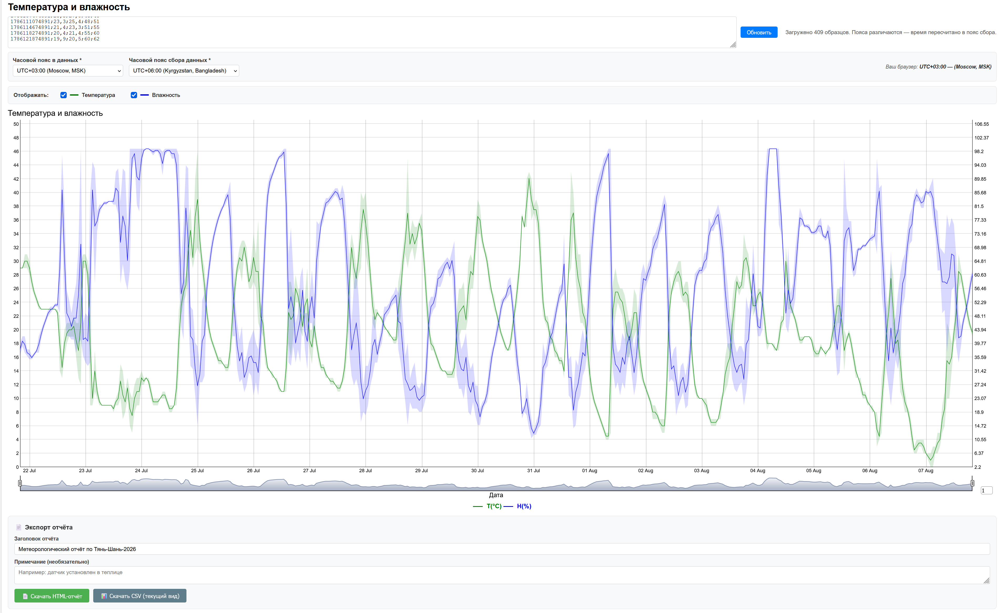

# 📊 Визуализатор данных с датчика Xiaomi Mijia LYWSD03MMC

Простое веб-приложение для построения интерактивного графика температуры и влажности на основе данных, выгруженных с датчика **Xiaomi Mijia LYWSD03MMC** через оригинальный инструмент [ATC_MiThermometer](https://pvvx.github.io/ATC_MiThermometer/).

   <!-- Не забудьте добавить скриншот и убедиться, что имя файла совпадает -->

---

## 🎯 Назначение

Программа преобразует CSV-файл с временными рядами температурных и влажностных измерений (с указанием минимальных/максимальных значений в интервале) в интерактивный график с двумя осями, отображением доверительных интервалов, скользящим средним и выбором диапазона.

### ✨ Ключевые возможности

- **Поддержка часовых поясов**: корректное отображение времени независимо от пояса, в котором были собраны данные, и пояса зрителя.
- **Управление видимостью серий**: возможность скрыть или показать линии температуры и влажности.
- **Экспорт отчёта**: сохранение текущего вида графика в виде самодостаточного HTML-файла или CSV.
- **Интерактивность**: наведение курсора показывает точные значения, ползунок внизу позволяет выбрать нужный временной промежуток, а поле в правом нижнем углу сглаживает шум.

---

## 📥 Подготовка данных (как получить CSV)

1. Перейдите на страницу выгрузки: [https://pvvx.github.io/ATC_MiThermometer/GraphMemoOriginal.html](https://pvvx.github.io/ATC_MiThermometer/GraphMemoOriginal.html)
2. Нажмите кнопку **Connect** и выберите свой датчик из списка.
3. Дождитесь окончания загрузки данных (индикатор покажет количество записей).
4. Нажмите **Save data to .csv file** – файл будет сохранён в формате:

   ```
   Time-Data:(A2/86400000)+25569;T1;T2;H1;H2
   1784246274891;14.4;15.6;45;59
   1784249874891;15.5;15.8;45;46
   ...
   ```

   - **T1, T2** – нижняя и верхняя границы температуры за интервал.
   - **H1, H2** – нижняя и верхняя границы влажности.

---

## 🚀 Использование программы

1. **Скачайте** файл `graph.html` из этого репозитория.
2. **Откройте** его в любом современном браузере (Chrome, Firefox, Edge, Opera).
3. **Вставьте** содержимое вашего CSV-файла в текстовое поле.
4. **Выберите часовые пояса**:
   - *Часовой пояс в данных* — пояс, в котором записаны таймстемпы в CSV.
   - *Часовой пояс сбора данных* — где физически находился датчик.
   
   Оба поля обязательны. Пока они не выбраны, график не строится.
5. Нажмите кнопку **«Обновить»** – появится интерактивный график.

### 🕐 Часовые пояса

Приложение автоматически пересчитывает время, чтобы ось X показывала **настенное время в часовом поясе сбора данных**, независимо от того, в каком поясе находится зритель.

- Если пояса совпадают, время отображается «как есть».
- Если различаются — применяется формула:

  ```
  скорректированное_время = сырое_время + (пояс_сбора − пояс_данных − пояс_браузера) × 1 час
  ```

### 🎨 Управление отображением

Под графиком расположены переключатели:

- ☑ **Температура** — показывает/скрывает зелёную линию.
- ☑ **Влажность** — показывает/скрывает синюю линию.

Скрыть обе серии одновременно нельзя — последняя активная галочка возвращается автоматически.

### 📄 Экспорт отчёта

После построения графика доступны две кнопки:

- **Скачать HTML-отчёт** — создаёт самодостаточный файл `report.html` с графиком, данными и настройками. Отчёт можно открыть на любом компьютере, и время на графике не сдвинется.
- **Скачать CSV (текущий вид)** — экспортирует данные только за выбранный период и только для видимых серий.

---

## 🛠️ Технические детали

- **Библиотека**: [Dygraph](https://dygraphs.com/) — быстрый и гибкий инструмент для визуализации временных рядов.
- **Данные**: поддерживается формат с интервалами (`customBars: true`), что позволяет отображать разброс значений.
- **Адаптивность**: график автоматически подстраивается под размер окна браузера.
- **Часовые пояса**: реализованы через фиксированные смещения от UTC (полный список от −12:00 до +14:00).

---

## 📸 Скриншоты



---

## 📝 Лицензия

MIT © 2026 – свободно используйте, модифицируйте и распространяйте.

---

## 🔗 Ссылки

- [Оригинальный проект ATC_MiThermometer](https://github.com/pvvx/ATC_MiThermometer)
- [Страница выгрузки данных](https://pvvx.github.io/ATC_MiThermometer/GraphMemoOriginal.html)
- [Документация Dygraph](https://dygraphs.com/)
